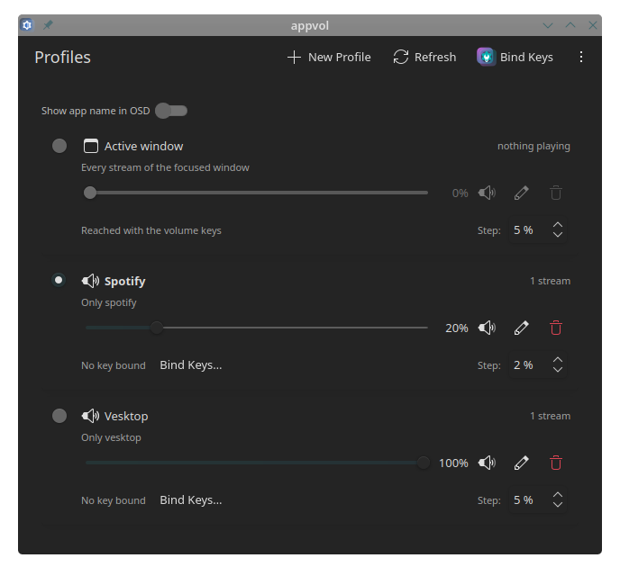

# appvol

Per-application volume control by hotkey for **KDE Plasma 6.8 (Wayland, PipeWire)**.

Press a key, and appvol changes the volume of every audio stream that belongs to
the application whose window is focused, showing the stock KDE OSD. Profiles
extend that to named targets: one key for the application of your choice, one
for everything except it.

<p align="center">
  
</p>

```
appvol up      # +5% for the focused application
appvol down    # -5%
appvol mute    # toggle mute
appvol list    # streams, cached focus, profiles, and which match step fired
appvol apps    # what is playing right now, with the identifiers profiles use
```

A user daemon on the session bus, a KWin script that reports the focused window,
and a thin client for the hotkeys. No root, no X11 tools. An optional window and
tray icon for the profiles come with the `appvol-gui` package.

## Quick start

```
tar xzf appvol-X.Y.Z.tar.gz && cd appvol-X.Y.Z
./install.sh --service
```

Then open **System Settings → Shortcuts**, search for "appvol" and bind
**Volume up**, **Volume down** and **Toggle mute**. That is all: the daemon
registers the actions itself.

## Requirements

Tested on **KDE Plasma 6.8, Wayland session**. Plasma 5 is not supported.

The session provides: `kwin` (focus), `plasmashell` (OSD), `kglobalacceld` and
System Settings (hotkeys), PipeWire with `pipewire-pulse`.

Python modules for the daemon and the CLI (`install.sh` checks them and names the
packages for your distribution):

| Package (Arch)    | Import name | Why                                     |
| ----------------- | ----------- | --------------------------------------- |
| `python` (3.11+)  | n/a         | `tomllib` for the config                |
| `python-dbus`     | `dbus`      | session bus: the daemon API and the OSD |
| `python-gobject`  | `gi`        | the GLib main loop the daemon runs in   |
| `python-pulsectl` | `pulsectl`  | stream volume through pipewire-pulse    |

The window and the tray icon are optional and additionally need `pyside6`,
`kirigami`, `qqc2-desktop-style` and `breeze-icons`. The daemon and the CLI never
import them, so a minimal install can leave them out.

## Install

### Release archive (any distribution, no root)

The archive from GitHub Releases (`appvol-X.Y.Z.tar.gz`) contains the whole
project plus `install.sh`:

```
tar xzf appvol-X.Y.Z.tar.gz
cd appvol-X.Y.Z
./install.sh --service        # into ~/.local; --uninstall reverts it
./install.sh --no-gui         # ... without the window and the tray icon
```

### Arch Linux

Split pacman packages from the release:

```
sudo pacman -U dist/appvol-*.pkg.tar.zst          # daemon + CLI
sudo pacman -U dist/appvol-gui-*.pkg.tar.zst      # window + tray icon
systemctl --user daemon-reload && systemctl --user enable --now appvold
```

### Debian / Ubuntu / Fedora

`.deb` and `.rpm` packages are built by the release workflow and attached to
every GitHub Release, with the same split as the pacman packages:

```
sudo apt install ./appvol_*.deb ./appvol-gui_*.deb    # Debian, Ubuntu, KDE neon
sudo dnf install ./appvol-*.rpm ./appvol-gui-*.rpm    # Fedora
systemctl --user daemon-reload && systemctl --user enable --now appvold
```

`appvol` pulls `python3-dbus`, `python3-gi` (or `python3-gobject`) and
`python3-pulsectl`; `appvol-gui` pulls PySide6 and Kirigami. Plasma 6 is
required, which rules out Debian 12 and Ubuntu 24.04.

### From the checkout

Without installing anything:

```
bin/appvold                # the daemon, logs to stderr
bin/appvol up              # in another terminal
```

## Hotkeys

appvol appears in **System Settings → Shortcuts** while the daemon runs, under
the entry **Appvol**, next to the other applications. Nothing has to be installed
or regenerated for it.

Bind **Volume up**, **Volume down**, **Toggle mute**, **Next profile** and
**Previous profile**. No keys are bound by default, and keyboard shortcuts stay in
System Settings; appvol never writes one.

## Profiles

A profile is a named target for the same volume keys. The **Active window**
profile is built in and needs no configuration; the profiles you create select
applications:

```
appvol profile add spotify --include spotify --name Spotify
appvol profile add desktop --exclude spotify --name "Everything but Spotify"
appvol profile toggle spotify   # or press its key; press again to go back
appvol profile list             # what exists, and which profile is current
appvol up --profile spotify     # one call, without switching to it
```

`--include` takes application identifiers; the reverse-DNS name also matches by
its last part, so `firefox` finds `org.mozilla.firefox`. An empty `--include`
means every application stream with the shell left out, and `--exclude` removes
applications, which is how an inversion profile is built. `--step`,
`--max-volume` and `--icon` override the config for that profile.
Profiles live in `~/.config/appvol/profiles.toml`, written by the daemon.

The daemon registers one action per profile in KGlobalAccel, so every profile
shows up in System Settings → Shortcuts under **Appvol**, next to the five fixed
actions. While a profile is current, the volume keys follow it. The OSD shows the
icon and the bar, and can also caption the application name: switch on **Show app
name in OSD** in the window.

**Next profile** and **Previous profile** walk through the built-in Active profile
and your profiles in the order the window lists them, wrapping around. Five
minutes without a key press return the keys to the Active profile.

## Window and tray icon

<p align="center">
  
</p>

`appvol-gui` (or `bin/appvol-gui` from the checkout) opens a small window listing
every profile with its live volume, its scope, the key bound to it and the step of
the volume keys, plus a tray icon with the profiles, the three volume actions and
**Quit**.

- The sliders and the mute switches act on the live streams.
- The step can be changed in the row itself.
- **New Profile** and **Edit** open a form whose application list is what is
  playing right now.
- **Bind Keys…** opens System Settings → Shortcuts. The window shows the binding
  and never sets one.

Details in [docs/gui.md](docs/gui.md).

## Config

`~/.config/appvol/config.toml`, every key optional:

```toml
step = 5                     # relative step in percent
max_volume = 100             # upper limit, up to 150
osd = true                   # show the KDE OSD
profile_idle_timeout = 300   # seconds before a profile returns to Active, 0 disables
# kwin_script = "/path/to/appvol.js"   # override the bundled KWin script
```

The window writes `step` here when the step of the Active profile is changed in
its row; the daemon leaves the rest of the file to you.

## Troubleshooting

```
appvol list                        # focus, streams, why nothing matched
appvol apps                        # what is playing, and how appvol names it
appvol profile list                # profiles and the current one
appvold -v                         # verbose daemon log
journalctl --user -u appvold -f    # when it runs under systemd
```

- **Nothing changes:** `appvol list` shows the cached focus. Windows on the panel
  or the desktop are ignored, and so is `plasmashell`. An application that is not
  playing anything has no stream to change yet.
- **The key does nothing:** the daemon is not running, or the key is not bound.
  See `systemctl --user status appvold`.
- **A profile key does nothing:** the action of that profile has no key yet.
  `appvol profile add` registers the action; assign the key in System Settings.
- **A profile matches nothing:** `appvol list` with the profile current shows the
  reason, and `appvol up --profile NAME` answers without switching.
- **No OSD:** check `osd = true` and a normal Plasma session, where `plasmashell`
  owns `org.freedesktop.Notifications`. The daemon logs `cannot show volume OSD`
  when the call fails.
- **The window does not start:** PySide6 is missing, or was installed after the
  last `install.sh`. `python3 -c "import PySide6"` answers it. The tray icon also
  needs a system tray in the panel.

## Documentation

- [docs/architecture.md](docs/architecture.md): components, D-Bus API, matching, lifecycle
- [docs/gui.md](docs/gui.md): the window and the tray icon
- [docs/osd.md](docs/osd.md): the OSD and how the application icon is chosen
- [docs/plasma-notes.md](docs/plasma-notes.md): what Plasma actually does
- [docs/development.md](docs/development.md): layout, tests, release process

## License

MIT, see [LICENSE](LICENSE).
