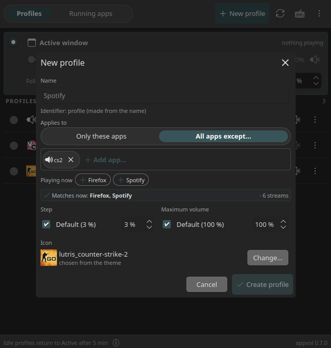
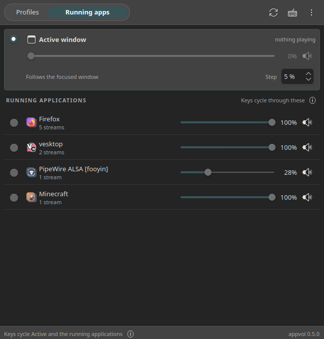

# appvol

<div align="center">

[Releases](https://github.com/YaBulochka/appvol/releases/latest) ·
[Quick start](#quick-start) ·
[Install](#install) ·
[Hotkeys](#hotkeys) ·
[Profiles](#profiles) ·
[Documentation](#documentation) ·
[Troubleshooting](docs/troubleshooting.md) ·
[Report a bug](https://github.com/YaBulochka/appvol/issues/new)

[](https://github.com/YaBulochka/appvol/releases/latest)
[](LICENSE)
[](https://github.com/YaBulochka/appvol/actions/workflows/release.yml)

</div>

Per-application volume control by hotkey for **KDE Plasma 6.8 (Wayland, PipeWire)**.

Press a key, and appvol changes the volume of every audio stream that belongs to
the application whose window is focused, showing the stock KDE OSD. **Profiles**
extend that to named targets, and **Auto mode** makes the keys cycle the focused
window and every application that is playing.

<p align="center">
  
</p>

Plasma's volume applet and `pavucontrol` set the volume of one application with
the mouse. appvol is for the keyboard: the volume of whatever you are looking at
goes up and down without leaving it.

```
appvol up      # +5% for the focused application
appvol down    # -5%
appvol mute    # toggle mute
appvol list    # streams, cached focus, profiles, and which match step fired
appvol apps    # what is playing right now, with the identifiers profiles use
appvol mode    # show the mode; "appvol mode auto" or "appvol mode profiles" switches it
```

A user daemon on the session bus, a KWin script that reports the focused window,
and a thin client for the hotkeys. The window comes with the `appvol-gui` package.

## Quick start

1. Download the packages for your system from the
   [latest release](https://github.com/YaBulochka/appvol/releases/latest) and
   install them; [Install](#install) has the command for each distribution.
2. Start the daemon:

   ```
   systemctl --user daemon-reload
   systemctl --user enable --now appvold
   ```

3. Open **System Settings → Shortcuts**, search for "appvol" and bind **Volume up**,
   **Volume down** and **Toggle mute**. That is all: the daemon registers the
   actions itself.

## Hotkeys

appvol appears in **System Settings → Shortcuts** while the daemon runs, under
the entry **Appvol**, next to the other applications. Nothing has to be installed
or regenerated for it.

Bind **Volume up**, **Volume down**, **Toggle mute**, **Next profile** and
**Previous profile**. No keys are bound by default, and keyboard shortcuts stay
in System Settings; appvol never writes one.

## Profiles

A profile is a named target for the same volume keys. The **Active window**
profile is built in and needs no configuration; the profiles you create select
applications:

```
appvol profile add spotify --include spotify --name Spotify
appvol profile add desktop --exclude spotify --name "Everything but Spotify"
appvol profile toggle spotify   # or press its key; press again to go back
appvol profile list             # what exists, and which profile is current
appvol up --profile spotify     # one call, without switching to it
```

<p align="center">
  
</p>

`--include` takes application identifiers; the reverse-DNS name also matches by
its last part, so `firefox` finds `org.mozilla.firefox`. An empty `--include`
means every application stream with the shell left out, and `--exclude` removes
applications, which is how an inversion profile is built. `--step`,
`--max-volume` and `--icon` override the config for that profile. The daemon
keeps the profiles in `~/.config/appvol/profiles.toml`.

Every profile is one more action under **Appvol** in System Settings → Shortcuts.
While a profile is current, the volume keys follow it. The OSD captions the
application name when **OSD App Name** is switched on in the **⋮** menu of the
window.

**Next profile** and **Previous profile** walk through the built-in Active profile
and your profiles in the order the window lists them, wrapping around. Five
minutes without a key press return the keys to the Active profile.

### Auto mode

The keys can instead follow the session. `appvol mode auto` — or the switch in
the window — replaces the profiles with the applications that are playing:
**Next profile** and **Previous profile** then walk Active and every application,
in the order the applications started. An application that stops playing leaves
the cycle, and one that starts joins its end. `appvol mode profiles` goes back,
and `appvol mode` alone reports the current one.

<p align="center">
  
</p>

The step and the ceiling stay global in the auto mode, and `profiles.toml` is
left untouched, so the two modes never overwrite each other.

## GUI

`appvol-gui` (or `bin/appvol-gui` from the checkout) opens a small window over the
profiles: the built-in **Active window** pinned at the top, then one line per
profile with its live volume, the streams it matches, the key bound to it, its
mute button and a **⋮** menu. A segmented control switches between **Profiles**
and **Running apps**. Closing the window quits the GUI; the daemon and the
hotkeys keep running.

- The sliders and the mute buttons act on the live streams.
- The **⋮** menu of a row holds **Bind Keys…**, **Step…**, **Edit…** and
  **Remove**; the step of the pinned Active card is the global one.
- **New profile** and **Edit…** open a dialog. A profile covers either the
  applications you name or every application except the ones you name, so an
  **Applies to** switch says which reading the list of chips has; what is playing
  is one click away, and a live **Matches now** line names what the draft would
  catch before you save it. The identifier is derived from the name as you type.
- **Bind Keys…** opens System Settings → Shortcuts. The window shows the binding
  and never sets one.

Details in [docs/gui.md](docs/gui.md).

## Requirements

Tested on **KDE Plasma 6.8, Wayland session**; Plasma 5 is not supported. The
session provides `kwin` (focus), `plasmashell` (OSD), `kglobalacceld` and System
Settings (hotkeys), and PipeWire with `pipewire-pulse`.

The packages pull in everything else. Only the no-root `install.sh` route needs
these Python modules by hand, and prints the command for your distribution:

| Import name | Arch package      | Debian, Ubuntu     | Fedora             |
| ----------- | ----------------- | ------------------ | ------------------ |
| `tomllib`   | `python` (3.11+)  | `python3` (3.11+)  | `python3` (3.11+)  |
| `dbus`      | `python-dbus`     | `python3-dbus`     | `python3-dbus`     |
| `gi`        | `python-gobject`  | `python3-gi`       | `python3-gobject`  |
| `pulsectl`  | `python-pulsectl` | `python3-pulsectl` | `python3-pulsectl` |

The window is optional and adds PySide6 and Kirigami
(`pyside6`, `kirigami`, `qqc2-desktop-style` and `breeze-icons` on Arch). The
daemon and the CLI never import them, so a minimal install can leave them out.

## Install

Download the files for your system from the
[latest release](https://github.com/YaBulochka/appvol/releases/latest) into a
directory and `cd` there. With the GitHub CLI, one command fetches them all:

```
mkdir appvol-pkg && cd appvol-pkg
gh release download --repo YaBulochka/appvol
```

**`appvol`** is the daemon and the CLI, **`appvol-gui`** the window, which depends
on `appvol`. Install both, or only `appvol` for a headless
install. Each block below starts the daemon with the session afterwards.

The files of a release (`X.Y.Z` is its version):

| Distribution             | Files                                                                     |
| ------------------------ | ------------------------------------------------------------------------- |
| Arch Linux               | `appvol-X.Y.Z-1-any.pkg.tar.zst` and `appvol-gui-X.Y.Z-1-any.pkg.tar.zst` |
| Debian, Ubuntu, KDE neon | `appvol_X.Y.Z-1_all.deb` and `appvol-gui_X.Y.Z-1_all.deb`                 |
| Fedora                   | `appvol-X.Y.Z-1.noarch.rpm` and `appvol-gui-X.Y.Z-1.noarch.rpm`           |
| any distribution         | `appvol-X.Y.Z.tar.gz`, the source archive with `install.sh`               |
| all of the above         | `SHA256SUMS`                                                              |

**Plasma 6 is required**, which rules out Debian 12 and Ubuntu 24.04 with its
stock Plasma 5. Debian 13, Ubuntu 25.04 and later, and Kubuntu 26.04 LTS ship
Plasma 6. KDE neon is still built on Ubuntu 24.04 LTS but carries Plasma 6 from
KDE's own repositories, so the `.deb` files should install there too; that is
not tested.

### Arch Linux

```
sudo pacman -U appvol-*.pkg.tar.zst        # appvol and appvol-gui
systemctl --user daemon-reload
systemctl --user enable --now appvold
```

### Debian / Ubuntu / KDE neon

```
sudo apt install ./appvol_*.deb ./appvol-gui_*.deb
systemctl --user daemon-reload
systemctl --user enable --now appvold
```

### Fedora

```
sudo dnf install ./appvol-*.rpm            # appvol and appvol-gui
systemctl --user daemon-reload
systemctl --user enable --now appvold
```

### Verify the download (optional)

`SHA256SUMS` lists every file of the release:

```
sha256sum -c SHA256SUMS --ignore-missing
```

### Any distribution, no root

The `appvol-X.Y.Z.tar.gz` archive carries the whole project and `install.sh`,
which copies it into `~/.local` and needs no package manager:

```
tar xzf appvol-X.Y.Z.tar.gz
cd appvol-X.Y.Z
./install.sh --service        # into ~/.local; --uninstall reverses it
./install.sh --no-gui         # ... without the window
```

### From the checkout

Without installing anything:

```
bin/appvold                # the daemon, logs to stderr
bin/appvol up              # in another terminal
```

### Uninstall

Stop the daemon first, then remove the packages (or run `./install.sh --uninstall`
for the no-root install):

```
systemctl --user disable --now appvold
sudo pacman -Rns appvol appvol-gui      # Arch
sudo apt remove appvol appvol-gui       # Debian, Ubuntu
sudo dnf remove appvol appvol-gui       # Fedora
```

## Documentation

- [docs/config.md](docs/config.md): every key of `config.toml`
- [docs/troubleshooting.md](docs/troubleshooting.md): when a key does nothing
- [docs/gui.md](docs/gui.md): the window
- [docs/architecture.md](docs/architecture.md): components, D-Bus API, matching, lifecycle
- [docs/osd.md](docs/osd.md): the OSD and how the application icon is chosen
- [docs/plasma-notes.md](docs/plasma-notes.md): what Plasma actually does
- [docs/development.md](docs/development.md): layout, tests, release process

## License

MIT, see [LICENSE](LICENSE).
